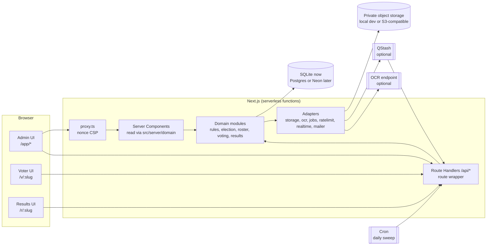
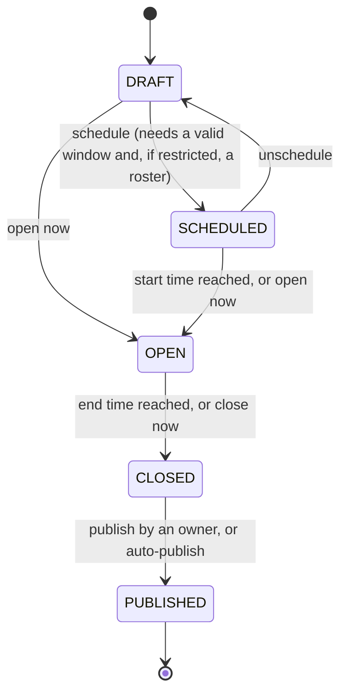
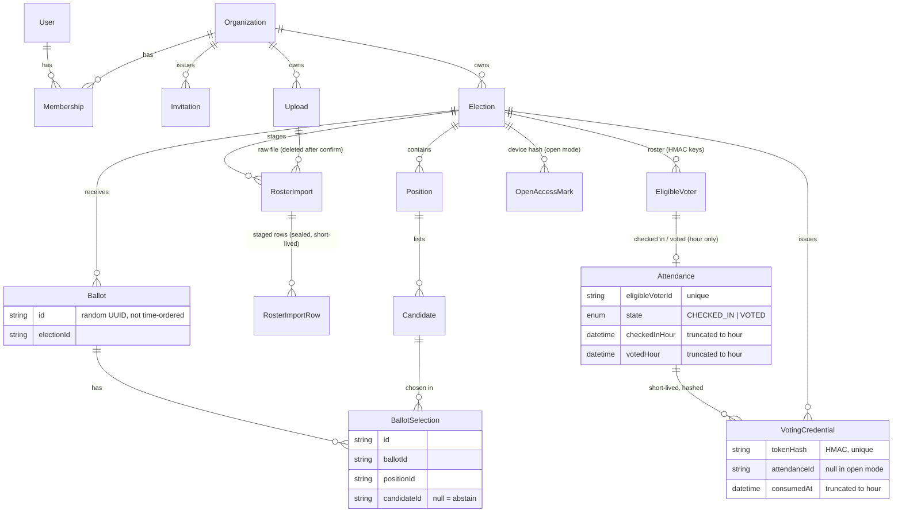

# Architecture

## Shape of the system

One Next.js application. No separate API service, no worker process, no cache server.

Everything that touches data, secrets or third parties lives under `src/server/` and starts with
`import "server-only"`, so a client component that imports it fails the build instead of leaking it.

## One request, end to end

Every Route Handler is built with `route(name, options, handler)` in `src/server/http.ts`. The order is fixed:

1. Request id (`X-Request-Id` on every response, including errors).
2. Origin check for state-changing methods (CSRF). Requires a same-site browser origin; cron and queue endpoints
   skip it because they authenticate with a secret or signature instead.
3. Rate limits (per user for admin calls, per keyed-hash IP for public calls).
4. Authentication (`auth: "user"` resolves the Better Auth session; `auth: "none"` is for the public voting surface).
5. Query and body validation with Zod `strictObject` schemas, JSON only, size-capped.
6. The handler, which calls a domain function that re-checks tenancy in its own query.
7. One error shape for every failure: `{ "error": { "code", "message", "requestId", "fields"? } }`.
   Unexpected errors are logged by type only and answered generically; request bodies are never logged.

Server Components read through the same domain functions (via the cached loaders in `src/lib/loaders.ts`), so the
pages and the API cannot disagree about who may see what.

## Modules

| Module | Responsibility |
| --- | --- |
| `domain/rules.ts` | Pure functions: lifecycle transitions, freeze, schedule problems, ballot validation, tally and tie decision, disclosure gate. No I/O, exhaustively unit-tested |
| `domain/election.ts` | Create/update/transition elections, `syncElection` (applies due deadlines on any read or write), link rotation, extend |
| `domain/ballot-config.ts` | Positions and candidates, editable only while the ballot is unlocked; text corrections after lock are audited |
| `domain/roster.ts` | Upload → parse → review → confirm pipeline, 24-hour freeze enforcement, manual rows |
| `domain/verification.ts` | Field kinds, normalization, HMAC lookup keys |
| `domain/voting.ts` | `verifyVoter` and `submitBallot`, the only writers of attendance, credentials, ballots |
| `domain/results.ts` | Tallies and analytics behind one gate; admin, public and export shapes |
| `domain/turnout.ts` | Participation counts and roll call (never choices) |
| `domain/sweep.ts` | Daily housekeeping; never required for correctness |
| `adapters/*` | `storage`, `ocr`, `jobs`, `ratelimit`, `realtime`, `mailer`: each is an interface with a safe default |

### Adapters

| Adapter | Default | Alternatives | Notes |
| --- | --- | --- | --- |
| Storage | `none` (503) | `local` (dev), `s3` | Private objects only. Uploads go to short-lived signed PUT targets; size and magic bytes are verified server-side after upload |
| Document extraction | `none` | `http` | Provider-neutral HTTP contract documented in `adapters/ocr.ts` |
| Jobs | `inline` | `qstash` | QStash deliveries are verified with the vendor SDK; handlers are idempotent |
| Rate limiting | `database` | `memory` (dev), `none` (fails closed) | One atomic upsert per hit; works on serverless without Redis |
| Realtime | polling | any provider implementing `Realtime` | Events carry no counts; clients refetch through gated endpoints |
| Mail | `none` | `console`, `resend` | Without mail, password reset is unavailable and verification is off |

## Time

`src/server/clock.ts` is the single source of "now". Deadlines are evaluated whenever an election is read or
written (`syncElection`), so an election opens and closes on time, and the roster freezes on time, even if the
daily cron never runs. The cron exists to tidy up (see [data-and-retention.md](data-and-retention.md)) and to
emit audit events for elections nobody looked at.

## Election lifecycle

- The roster freezes 24 hours before the start time, or immediately when voting opens early or is scheduled inside
  that window. Once `rosterFrozenAt` is set it is never cleared, even if the election is rescheduled.
- The ballot is editable only in Draft and Scheduled before the start time. After that, only audited text corrections.
- Only an organization owner may publish, change the disclosure policy, change the tie rule, or toggle auto-publish.

## Results gating

One decision function, used by every surface (admin pages, public page, API, export, realtime):

| Disclosure | Audience | Tallies visible | Analytics visible |
| --- | --- | --- | --- |
| `LIVE` | Admin | Open, Closed, Published | Closed, Published |
| `LIVE` | Public | Open, Closed, Published | Closed, Published |
| `AFTER_CLOSE` | Admin | Closed, Published | Closed, Published |
| `AFTER_CLOSE` | Public | Published only | Published only |

Not visible means the server returns `{ available: false, reason: "not_started" | "voting_open" | "awaiting_publication", election }`
and nothing else. Nothing is computed for the hidden case, so there is nothing to leak. Group-level turnout is
admin only and never appears in the public analytics payload (`groups: null`).

Counting is plurality: each selected candidate gets one vote and the top `seats` candidates win. Ties are reported,
never broken silently. If the candidates at the cutoff are tied for more seats than remain, none of them is declared
a winner; the position shows who is clear of the tie, who tied, and how many seats are open. The election's tie
rule only changes the wording ("tie" versus "runoff required"); there is no random draw and no tiebreak by name.
Candidates with zero votes are never elected.

## Data model

**The privacy boundary is the absence of a line.** The left half (`EligibleVoter`, `Attendance`,
`VotingCredential`) answers "who took part". The right half (`Ballot`, `BallotSelection`) answers "what was
chosen". There is no foreign key, shared id, token, or timestamp that joins them. `AuditEvent` and
`RateLimitBucket` stand alone (they are not shown above). `AuditEvent`, `Ballot` and `BallotSelection` are
append-only at the database level (SQLite triggers; Postgres role grants and triggers).

The schema is portable on purpose: no native database types, no scalar lists, no `@map`, JSON columns only through
Prisma's `Json`. The one hand-written SQL statement (the rate-limit upsert) is valid on both SQLite 3.35+ and
PostgreSQL.

## Concurrency

Race safety comes from compare-and-swap updates and unique constraints, never from check-then-write.

| Hazard | Mechanism |
| --- | --- |
| Same credential submitted many times at once | `UPDATE credential SET consumedAt … WHERE consumedAt IS NULL AND revokedAt IS NULL AND expiresAt > now` → exactly one row |
| Same voter verifies twice at once | `Attendance.eligibleVoterId` unique; losing insert is caught as a unique violation; one live credential per voter (earlier one is revoked) |
| Voter votes twice via two credentials | `UPDATE attendance SET state='VOTED' WHERE state='CHECKED_IN'` → exactly one row |
| Open-access double vote | Insert into `OpenAccessMark` under primary key `(electionId, deviceHash)` |
| Ballot arrives after close | `UPDATE election … WHERE status='OPEN' AND endsAt > now` inside the same transaction |
| Roster edit at the freeze instant | Freeze is checked inside the write transaction, not before it |
| Double-click confirm on an import | Status compare-and-swap (`NEEDS_REVIEW → CONFIRMING`); second call reads the finished state |
| QStash redelivers a parse job | Handler claims the import with a status compare-and-swap; a redelivery finds it already claimed |

The three writes of a ballot submission (spend credential, mark attendance, insert ballot) are one transaction.
If any step fails, nothing is recorded.

**Tradeoff to know about.** The election row is a deliberate hot row: every submission touches it to prove the
election is still open. On PostgreSQL this serializes concurrent submissions per election on a row lock. That is
fine at the scale this product targets (clubs and societies), but run a load test at your expected peak before a
large election. The tests that exercise races run on SQLite, whose single synchronous writer proves the ordering of
the checks but not behavior under PostgreSQL contention.

## Front end

- Server Components by default; client components only where there is interaction (forms, tabs, charts, the voter flow).
- Dates cross the server/client boundary as props; the API client throws a typed `ApiError(code, message, status, fields)`.
- Charts are hand-built SVG with tooltips, keyboard focus and a table view; no chart library, no canvas.
- The voter's credential lives only in component memory. It is never written to storage, URLs or cookies.
- Pages that read the database without cookies are `force-dynamic`; `/v` and `/r` set `noindex` and `no-referrer`.
- The theme is the `theme` cookie, default light. There is no system-preference detection.
