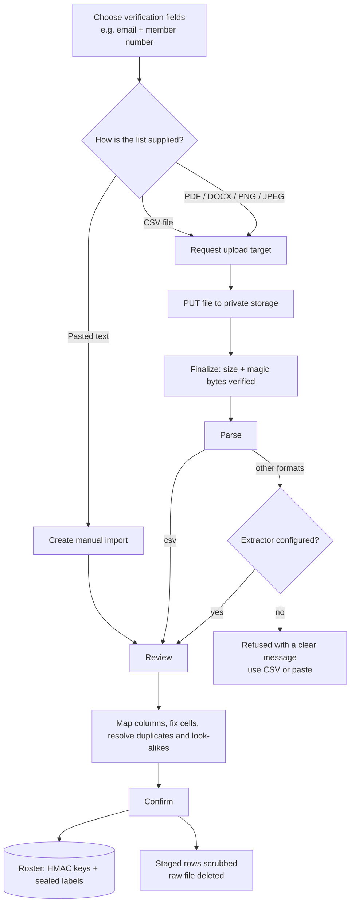

# Roster ingestion

How a voter list becomes the set of people allowed to vote. This applies to **restricted** elections. Open-access
elections have no roster.

## What an administrator does

1. **Pick what voters prove.** One to four verification fields, each a `text`, `email`, `id` or `pin` kind. The
   first field is the "primary" identity (usually an email or member number).
2. **Supply the list.** Upload a file, or paste CSV text. Files go straight to private object storage through a
   short-lived signed `PUT` target; the app never proxies the bytes on the request path. Uploads are idempotent on an
   optional `idempotencyKey`, so a retried request returns the same slot.
3. **Parse.** CSV is parsed with Papa Parse: header row required, up to 40 columns, up to `MAX_ROSTER_ROWS`
   (20,000) rows, control characters stripped, cells capped at 400 characters. Parsing runs inline for small files or
   as a durable job (see below).
4. **Review.** Every row gets a status. Errors block confirmation. The column mapping is suggested from header names
   (`Email address`, `Reg No`, `Class` and similar) and can be changed; the review re-evaluates all rows when it does.
5. **Confirm.** One transaction re-evaluates against the roster as it is at that moment, writes the voters, scrubs the
   staged data, and records the audit event. Confirming twice is a no-op.

## Row statuses

| Status | Meaning | Blocks confirm? |
| --- | --- | --- |
| `OK` | All verification fields present and valid | No |
| `WARNING` | Valid, but the name is missing (a masked label is used) or extraction confidence was below 0.8 | No |
| `ERROR` | A verification field is missing or invalid (for example a malformed email) | **Yes**, until fixed or skipped |
| `DUPLICATE` | Identical verification values already appear earlier in the file or on the roster | No (the duplicate is dropped) |
| `AMBIGUOUS` | Same first field but different other values, in the file or on the roster ("look-alikes") | **Yes**, until you choose **Keep** or **Skip** |
| `SKIPPED` | You chose to skip it | No |

A look-alike is never merged or dropped silently. If two rows share an email but differ in member number, someone must
say whether they are two people or a typo. Issue codes (`missing:email`, `duplicate:file`, `ambiguous:roster`) are
stored instead of values, so the review screen can explain a problem without the database holding the data twice.

PIN columns are masked in review listings.

## What is stored, and in what form

| Data | Form | Lifetime |
| --- | --- | --- |
| Verification values (email, member number, PIN) | **Never stored.** Only `lookupKey = HMAC(all normalized fields)` and `primaryKey = HMAC(first field)` | Life of the election |
| Roll-call label (a name, or a masked identifier if no name) | AES-256-GCM sealed, bound to the election | Life of the election |
| Group label (class, department) | Plain text, capped at 60 characters | Life of the election |
| Staged row cells during review | AES-256-GCM sealed per row, bound to import and row index | Until confirm or reject; swept after `RAW_UPLOAD_RETENTION_HOURS` (24) at the latest |
| Raw uploaded file | Private object storage | Deleted at confirm or reject; swept after 24 hours at the latest |

Why HMAC and not a plain hash: student numbers and PINs are low-entropy, so an unsalted hash of them can be reversed
by guessing. An HMAC under a server-held key cannot be, unless the key leaks. The key is derived from `APP_SECRET`
(HKDF, separate subkeys per purpose). **Anyone holding both the database and `APP_SECRET` can test guesses**, which is
why `APP_SECRET` never lives in the database or the repository.

Normalization before hashing: Unicode NFKC and trim for everything; lowercase for emails; whitespace removed and
lowercased for IDs; whitespace collapsed and lowercased for plain text fields; PINs are kept exactly as typed.

## The 24-hour freeze

Roster writes (import, confirm, add/correct row, remove voter) are rejected from **24 hours before the start time**,
and always once voting is open. The check lives inside the write transaction (a compare-and-swap on the election row),
not before it, so a request that races the freeze instant either lands entirely before it or is refused entirely.

- Scheduling inside the window freezes immediately. An empty restricted roster cannot be scheduled that close to the
  start, because it could never be fixed.
- `rosterFrozenAt` is set the first time the freeze is enforced and is never cleared. Moving the start time later does
  not thaw a frozen roster.
- The freeze applies to staged work too: a parse job that starts after the freeze fails with `ROSTER_FROZEN`.

## Document formats (PDF, Word, images)

These need a text/table extractor, which Quorum does not include. Behavior by configuration:

| `OCR_DRIVER` | PDF, DOCX, PNG, JPEG |
| --- | --- |
| `none` (default) | Refused at parse time with a plain-language message. CSV and pasted text still work. Nothing pretends to have been read |
| `http` | The file is sent to `OCR_ENDPOINT_URL`; a table comes back |

The HTTP contract is documented at the top of `src/server/adapters/ocr.ts` so you can put Azure Document
Intelligence, AWS Textract, Google Document AI, or your own service behind it. Requests are time-limited and retried at
most twice on 429/5xx/timeouts with an `Idempotency-Key`. Each row can carry a confidence score; rows below 0.8 become
warnings and the review screen asks you to look at them.

**Privacy.** Enabling `http` means a third party receives your voters' personal data. Do it deliberately, check that
processor's retention terms, and tell your voters. In production, non-CSV formats run only when `JOB_DRIVER=qstash`,
because they can outlive a serverless request.

## Background parsing

| `JOB_DRIVER` | Behavior |
| --- | --- |
| `inline` | Parse inside the request. CSV only in production, and files above `INLINE_PARSE_MAX_ROWS` (5,000) fail with `TOO_LARGE_FOR_INLINE` rather than timing out |
| `qstash` | The parse is published to QStash and delivered to `POST /api/jobs/run` with a verified signature. Retried by QStash |

Jobs are idempotent: the handler claims the import with a status compare-and-swap (`UPLOADED|FAILED → PARSING`), so a
redelivered message is a no-op, and rows are replaced in a single transaction, so a retry never duplicates them. A job
that dies mid-way leaves the import in `PARSING`; the daily sweeper moves anything stuck for 15 minutes to `FAILED`
(`STUCK`) so it can be retried from the UI.

## Manual entry

Paste CSV text (with a header row) or start from nothing and add rows one at a time in the review screen. Manual
imports go through exactly the same review, mapping, duplicate detection and freeze as uploaded files.

## Limits worth knowing

- The review screen loads the staged rows page by page, but evaluation decrypts and re-checks every row of the import
  in one transaction. At the 20,000-row cap that is fast on Postgres; on very slow hosts keep rosters smaller or split
  them into several imports.
- The roster and roll-call lists decrypt labels in memory to search and sort. This is fine at the supported size and
  is the reason for the 20,000-row cap.
- Verification collects whatever fields you choose. Prefer fields voters already know and that are not guessable by
  others in your community. Name plus class year is weak; an email plus a member number issued out-of-band is better.
